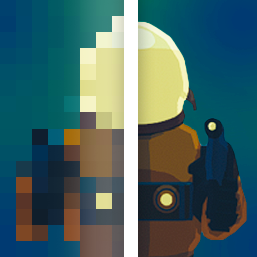

# Risk of Rain Upscaling

Introduces upscaling and frame generation to Risk of Rain 2, using **NVIDIA DLSS** or **AMD FSR**.

## What it does

- **Upscaling:** the game renders at a lower resolution and the mod rebuilds a clean full-resolution image. The game is already light, so depending on your system and FPS, you may lose frames instead of gaining any. Consider this an anti-aliasing option more than performance saving at high framerates. 
- **Frame Generation:** adds generated frames between the real ones for smoother motion: up to 6x on NVIDIA, 2x with FSR. On RTX 50 series cards, **Dynamic** lets DLSS pick how many frames to generate to reach your Framerate Limit or your monitor's refresh rate.

## Will it work on my PC?

| Graphics card | Upscaling | Frame Generation |
| --- | --- | --- |
| NVIDIA RTX 50 series | DLSS | DLSS, 2x–6x or Dynamic |
| NVIDIA RTX 40 series | DLSS | DLSS, 2x |
| NVIDIA RTX 20 and 30 series | DLSS | FSR, 2x |
| AMD, Intel and others | FSR | FSR, 2x |

The mod picks the right option for your card automatically. Windows only for now; it hasn't been tested on AMD hardware, Linux or Steam Deck yet.

## Install

**With a mod manager (easiest):** in [r2modman](https://thunderstore.io/package/ebkr/r2modman/) or the Thunderstore Mod Manager, search for **Risk of Rain Upscaling** and click **Install**.

Also install **[Risk of Options](https://thunderstore.io/package/Rune580/Risk_Of_Options/)**. It's optional, but it gives you an in-game settings menu.

**Manually:** install [BepInEx 5](https://thunderstore.io/package/bbepis/BepInExPack/), then copy the `BepInEx` folder from the download into your game folder, keeping its `plugins` and `patchers` folders.

## Getting started

1. **Launch the game.** The mod starts in DLAA / Native AA: better anti-aliasing at your normal resolution.
2. **Want more FPS?** Go to **Settings → Mod Options → Risk of Rain Upscaling** and set **Upscaler Quality** to **Quality** or **Balanced**. Lower settings are faster but softer.
3. **Want smoother motion?** Turn on **Frame Generation**, then restart the game. Play in **Borderless** or **Windowed** mode.

## FAQ

**Frame Generation won't turn on.**
Restart the game after enabling it, and don't use exclusive fullscreen.

**The image looks too sharp or too soft.**
Adjust **Sharpening** (0 turns it off, 1 is strongest).

**Fine textures shimmer.**
Raise `MipBiasOffset` toward 0 in the config file.

**How do I turn it off?**
Set the upscaling level to "Off".

**I found a bug.**
Set **Logging Level** to **Info**, reproduce the problem, then open an issue on the mod's GitHub page and attach the `BepInEx/RiskOfRainUpscaling-Diagnostics` folder from your profile.

## Settings

Change settings in-game under **Settings → Mod Options → Risk of Rain Upscaling** (needs Risk of Options), or edit `BepInEx/config/xanderfrangos.riskofrainupscaling.cfg`.

All settings

| Section | Settings |
| --- | --- |
| `[General]` | `Enabled`: master switch for everything the mod does. |
| `[Upscaling]` | `Enabled`, `Quality` (default DLAA), `Upscaler` (Auto, DLSS, FSR), `DLSS Preset`, `Outlines`, `Sharpening`, `MipBiasOffset`, `MainMenu`. |
| `[Frame Generation]` | `Enabled` (default off), `Multiplier`, `Dynamic` (DLSS only; aims the output at the Framerate Limit, or the refresh rate when unlimited), `Backend` (Auto, DLSS, FSR), `ReflexFrameLimiter`. Turning Frame Generation on when it was off at startup needs a restart; changing `Backend` always does. |
| `[Diagnostics]` | `Logging Level` (default Off), `ShowOverlay`, `CaptureWhileOff`, `TraceGraphicsStartup` (leave on; DLSS and Frame Generation need it). |
| `[Hotkeys]` | `Enable Hotkeys` (default off) and five rebindable shortcuts. |

Hotkeys

Most players won't need these. Turn on **Hotkeys → Enable Hotkeys** to use them.

| Default | Action |
| --- | --- |
| F10 | Toggle upscaling (also retries after an error) |
| F7 | Cycle upscaler quality |
| F11 | Toggle Frame Generation |
| F6 | Debug overlay |
| F8 | Capture diagnostics |

## For developers

See [building from source](docs/BUILDING.md), the [architecture overview](docs/ARCHITECTURE.md) and the [changelog](CHANGELOG.md).

## License

The mod is under the [MIT License](LICENSE). It bundles NVIDIA DLSS/Streamline and AMD FidelityFX under their own licenses; see [third-party notices](THIRD_PARTY_NOTICES.md). Not affiliated with NVIDIA, AMD, Hopoo Games or Gearbox.
